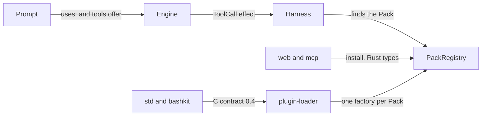
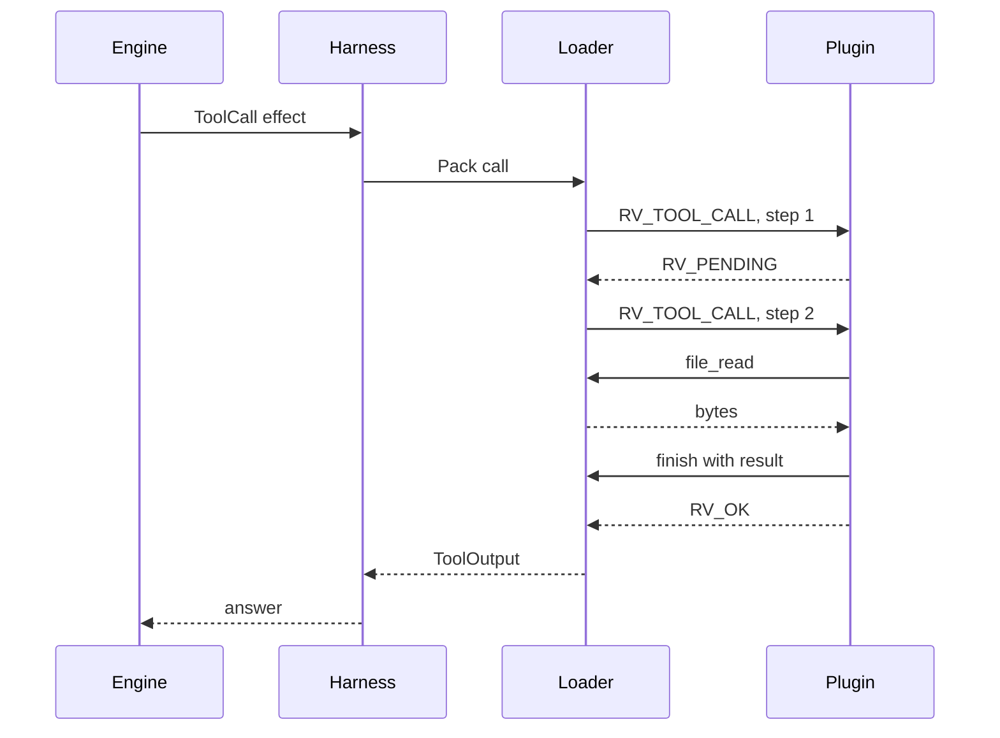

# How Runvil Plugins Work

*From a Plugin to a tool call, explained three times, each time in more detail, as the code stands on 2026-11-13*

This tutorial is for a Rust developer who is new to Runvil and is about to own its Plugin system. You have written a prompt, and you have written a Plugin that is linked into the Host and adds a Pack with one tool that fetches from a website. Now you need the whole picture: the Plugin API, the SDK, what a Plugin can and cannot do, and where the two are heading. The tutorial tells the same story three times: in one paragraph, in five, and then section by section with the detail a programmer needs.

Read all of it as a snapshot. The Plugin system is being built a piece at a time, and what is here is what exists now, not the final design. The contract can read a run's files and has no function that writes one. Half the shipped Packs use an older Rust API that the other half cannot reach. Wherever something is missing, the text says whether it is planned, left out on purpose, or undecided.

- Engine, Harness, and loader: `runvil-harness` at `18361d02`
- C contract and SDK: `runvil-plugin-api` at `03a9fa3`, contract version 0.4
- `std` Plugin: `runvil-plugin-std` at `ee04d10`
- bashkit Plugin: `runvil-plugin-bashkit` at `9c8e980`
- Workshop: `runvil-workshop` at `f386801b`
- Design pages: `runvil-design` at `b3c101a`, plus the Plugin updates of 2026-11-13 that were made alongside this tutorial

Everything below was read in the code at those commits. Nothing was built or run for this tutorial. Where a design page or a doc comment says something else, the code wins, and section 13 lists the differences that are likely to trip you up.

## In one paragraph

A Runvil Plugin is an entry point that installs Packs, and a Pack is a named set of tools. A prompt asks for a Pack by listing it under `uses:`, and a section's Lua offers the Pack's tools to its model. When a model or a script calls one of those tools, the Engine does not run it. The Engine emits the call as an effect, and the Harness finds the Pack and runs the call. The Plugin API is the line between the Harness and the Pack: how a Plugin names itself, how it lists its Packs and tools, how a call runs, and how a tool reaches the files of its run. Today that line exists twice. Plugins that ship as a dynamic library, `std` and `bashkit`, cross a small C contract, version 0.4, through a safe Rust SDK. Plugins that are compiled into the Host as Rust, `web` and `mcp`, use a second and richer API made of the Harness's own Rust types. The direction of the project is one API, the contract, for both kinds, so that an improvement to one is an improvement to all. Neither side is finished. The contract can read a run's files and cannot change them yet, and it lacks seven things that `web` and `mcp` depend on. This tutorial describes both APIs as they are and lists every difference between them.

## In five paragraphs

Start with the three nouns. A tool is one operation the Harness performs for a run, such as fetching a page. A Pack is a named set of tools, such as `runvil/web`, whose two tools are `web/fetch` and `web/search`. A Plugin is an entry point that installs zero or more Packs. A prompt lists the Packs it needs under `uses:` in its frontmatter, and every Pack listed there is required: a Host that lacks one refuses the prompt before it runs. Inside a section, Lua offers tools to the model with `tools.offer`, and Lua can also call a tool itself with `tools.call`. Lua names a tool by its tool id, `web/fetch`. The model sees it under a wire name, `web_fetch`, and a call under either name reaches the same tool. The Host, such as Workshop, decides which Plugins exist at all. At startup it fills one `PackRegistry`, and every run it starts draws its Packs from that registry.

A Plugin has a short life cycle with four levels. The Host loads the Plugin once, and during the load the Plugin names itself and inserts its Packs. For each run that holds one of those Packs, the Host asks the Plugin for an instance of the Pack, and the instance lists its tools, which stay fixed for that run. Each tool call on that instance then runs as a series of short steps: a step either ends the call with a result or asks for another step. When the run ends, the Host frees the instance, and when the last holder of the Plugin lets go, the Host unloads it. What every run shares, such as an HTTP client, lives in the Plugin instance. What one run needs lives in the Pack instance. What one call needs lives in the call's own state. In the C contract those four levels are six verbs sent to one function.

Through the contract, a tool can do a small and definite set of things today. It receives its own name and the call's arguments as JSON text. It returns text that it marks as trusted or untrusted, or it fails with one of four kinds of failure and a message the model reads. It can look at the files of its run through three functions that stat a path, list a directory, and read a range of bytes, and each one goes through the Host so the run's file policy applies. That is all. A tool cannot write or delete a file, cannot read any configuration from the Host, gets no async runtime or other service from the Host, cannot learn who called it, and cannot ask to be woken later, so a call that waits on a network reply is stepped again and again until it finishes. A Plugin also shares the Host's process, which brings rules of its own: no panic may cross the boundary, and every thread the Plugin started must stop before the unload returns.

There are two ways to write a Plugin today, and that is the main thing to understand before you change anything. The first is the contract. A Plugin written against `runvil-plugin-sdk` implements two traits, `Plugin` and `Pack`, and the SDK turns them into the C entry point. `std` and `bashkit` are built this way and ship as dynamic libraries. The second is older. A Plugin crate inside `runvil-harness` exports a Rust function named `install`, which receives the Host's `PackRegistry`, a JSON configuration, and a map of Host services, and it implements a different `Pack` trait from the crate `runvil-plugin`. `web` and `mcp` are built this way and are compiled into Workshop. The second way can do much more: configuration, services, a Lua prelude, readiness, per-model tool shaping, four tool flags, the call's origin, and seven file operations that change files. Every one of those is an internal API that a contract Plugin cannot reach. If people keep writing against it, there are two ways to do everything, and work on one never reaches the other.

So the first job is the inventory in section 9: every ability the Rust path has that the contract lacks, and which shipped Pack uses it. Seven of them stand between `web` and `mcp` and the contract. The rest have no shipped user and can wait. After that come the pieces that Packs on the contract are already waiting for: functions that change files, which the `std` tools Write, StrReplace, and Delete and the `bash` shell all need, and a wake function, so that a waiting call stops costing empty steps. The contract grows only when a Plugin that exists needs something, and while its major version is 0, every version is its own contract: a Plugin built for 0.4 loads only in a Host that speaks exactly 0.4. Expect it to change under you, and expect to be the one changing it.

## Section by section

Here is the same story again, one piece at a time.

### 1. The words and the map

Six words have one meaning each in every Runvil repository, and they are always capitalized.

- **Engine**: the crates that parse a prompt and step a run. The Engine performs no tool call itself. It emits an effect and waits for an answer.
- **Harness**: the crates that step the Engine, perform each effect, and record the run. The Harness's loader is the only production code that calls a Plugin's entry point.
- **Host**: an application that runs prompts through the Harness, such as Workshop. The Host chooses which Plugins load.
- **Pack**: code which installs an optional native prelude, an optional Lua prelude, and zero or more tools.
- **Plugin**: an entry point which installs zero or more Packs.
- **tool**: not capitalized. One operation with a name, a description a model reads, and a JSON Schema for its arguments.

The definition of a Pack is ahead of the code. Through the contract, a Pack is tools only. Through the Rust `install` path, a Pack is tools and an optional Lua prelude. No path has a native prelude.

The code is spread over five repositories.

| Repository | Crate or file | What it is |
|---|---|---|
| `runvil-plugin-api` | `crates/runvil-plugin-sys` | The C contract as raw Rust types, and the generated header `include/runvil_plugin.h` |
| `runvil-plugin-api` | `crates/runvil-plugin-sdk` | The safe Rust layer: the `Plugin` and `Pack` traits, `export_plugin!`, `entry`, and a fake Host for tests |
| `runvil-plugin-api` | `examples/hello-plugin` | The smallest complete Plugin |
| `runvil-harness` | `crates/harness-internal/plugin-loader` | The Harness's loader, which speaks the contract to every entry point |
| `runvil-harness` | `crates/harness-internal/runner` | Picks the Packs of each run, makes their instances, and performs tool calls |
| `runvil-harness` | `crates/runvil-plugin` | The older Rust-only API: `PackRegistry`, `Pack`, `PackFactory`, `ToolContext`, `HostServices` |
| `runvil-harness` | `crates/plugin-web`, `crates/plugin-mcp` | The two Plugins written against `runvil-plugin` |
| `runvil-harness` | `crates/runvil` | The one crate a Host depends on. It re-exports the loader's functions as `runvil::harness` and the Rust-only API as `runvil::plugin` |
| `runvil-plugin-std` | `crates/plugin-std` | The `std` Plugin, written against the SDK |
| `runvil-plugin-bashkit` | `crates/plugin-bashkit` | The bashkit Plugin, written against the SDK |
| `runvil-workshop` | `crates/workshop/server/src/agents.rs` | Where Workshop fills its `PackRegistry` |
| `runvil-workshop` | `crates/workshop/plugin-std`, `crates/workshop/plugin-bashkit` | Two one-line crates that build the libraries Workshop ships |



A Pack gets into a Host in one of three ways today. Learn these three names, because the code and the docs use the word "linked" for two of them.

| Way | What the Plugin is | Written against | How the Host inserts it | Who uses it |
|---|---|---|---|---|
| Rust `install` | A Rust function `install(packs, config, services)` | `runvil-plugin` | The Host calls the function | `plugin-web`, `plugin-mcp` |
| Linked contract Plugin | A C entry point compiled into the Host, such as `runvil_plugin_sdk::entry::<P>` | `runvil-plugin-sdk` | `runvil::harness::insert_plugin(packs, entry)` | Nobody ships one. The loader's unit tests use it |
| Library Plugin | A dynamic library that exports `runvil_plugin` | `runvil-plugin-sdk` | `runvil::harness::insert_plugin_dir(packs, directory)` | `std`, `bashkit` |

The second and third ways are the same contract. Both go through one private `load` function in the loader, and nothing after it looks at where the entry point came from. The first way is a different API. When someone says a Pack is "linked in", ask which of the first two they mean: the crate docs of `runvil-plugin` call the first way a linked Plugin, while the loader's `PluginSource::Linked` means the second. In this tutorial, "the contract" means the second and third ways together, and "the Rust `install` path" means the first.

Two more Packs go through neither API. `runvil/user` and `runvil/subagents` are built into every `PackRegistry`, in `runvil-plugin/src/registry.rs`, and have no tools. A prompt that needs a person declares `user`, and the Harness makes that Pack unavailable to a run that has no user.

### 2. Your Plugin, seen from a prompt

A prompt reaches a tool through three names. Suppose a Plugin inserts a Pack named `acme/site` with one tool named `fetch`.

````markdown
---
name: front-page
runvil: 0
uses: [acme/site]
---

## Fetch

```lua
return tools.call('site/fetch', { url = 'https://example.com/' })
```
````

| Name | Example | Who writes it |
|---|---|---|
| Pack name | `acme/site` | The Plugin, when it inserts the Pack. A vendor and a Pack id joined by `/` |
| Pack id | `site` | Nobody. It is the second segment of the Pack name |
| Tool name | `fetch` | The Pack, when it lists its tools. One segment |
| Tool id | `site/fetch` | The Host forms it from the Pack id and the tool name. Lua uses it |
| Wire name | `site_fetch` | What the model calls the tool. The Pack may set one, or the Host derives it from the tool id by turning `/` and `.` into `_` |

Four rules follow from the code in `harness-internal/runner/src/packs.rs`, and each one matters to a Plugin author.

- **A bare `uses:` entry means the `runvil` vendor.** `uses: [web]` and `uses: [runvil/web]` are the same entry. A Pack from any other vendor is written in full, as `acme/site`.
- **A run holds every `runvil` Pack, and another vendor's Pack only when the prompt declares it.** So a Pack named `acme/site` gets no instance, and costs nothing, in a run whose prompt leaves it out.
- **A run holds one Pack per Pack id.** A prompt that declares `acme/web` gets that Pack in place of `runvil/web`, and `web/fetch` then names a tool of `acme/web`.
- **Every `uses:` entry is required.** When the registry lacks the Pack, `Host::parse` refuses the prompt with a notice that begins `the environment cannot satisfy this prompt:` and has one line for each Pack, such as `- site is unavailable: acme/site is not installed`.

To put a tool in front of a model, a section's Lua offers it, as `tools.offer('site')` for the whole Pack or `tools.offer('site/fetch')` for one tool. At the section's first model round the Engine builds the tool list from those offers, and the model then sees each tool as a wire name, a description, and a parameter schema. That description and schema are text your Pack wrote, so they are part of your Plugin's interface as much as the code is. The language guide's chapter on tools covers the prompt author's side in full.

### 3. The contract: one function and six verbs

The contract is the file `crates/runvil-plugin-sys/src/lib.rs` in `runvil-plugin-api`. Its crate docs are the whole agreement in prose, and the C header is generated from it, comments included, so the two cannot disagree. Read that file once from top to bottom. It is about 600 lines and nothing else in the system is as exact.

A Plugin is one function:

```c
RvStatus runvil_plugin(RvCall *call);
```

Every call passes an `RvCall` that names a verb. The struct has seven fields: its own `size`, the `verb`, a pointer to `host` (an `RvHost`, which holds the contract version the Host speaks and nothing else), a pointer to the verb's own arguments in `args`, and three pointers that belong to the Plugin: `plugin`, `pack_run`, and `tool_call`. The Host stores those three and passes them back, and it never reads through them. They are how the Plugin finds its own state at each of its levels.

| Verb | Number | Arguments | When the Host sends it | What the Plugin does |
|---|---|---|---|---|
| `RV_PLUGIN_LOAD` | 1 | `RvLoadArgs` | Once, as the Host inserts the Plugin | Makes its instance and sets `call->plugin`, names itself once, inserts each Pack |
| `RV_PLUGIN_UNLOAD` | 2 | none | When the last holder of the Plugin drops it | Frees `call->plugin` and stops every thread it started |
| `RV_PACK_NEW` | 3 | `RvPackNewArgs` | Once for each run that holds the Pack | Makes the run's instance and sets `call->pack_run`, adds each tool |
| `RV_PACK_DELETE` | 4 | none | When the run ends | Frees `call->pack_run` |
| `RV_TOOL_CALL` | 5 | `RvToolCallArgs` | Once for each step of a tool call | Does a bounded slice of work, then asks for another step or ends the call |
| `RV_TOOL_CANCEL` | 6 | none | When the Host abandons a call between two steps | Frees `call->tool_call` |

Numbers 7 and 8 are reserved, and so are status codes 1 to 3. The contract declares no constant for them. Older records name verb 7 for a prelude and verb 8 for a render step, which are two of the things section 9 lists as missing.

The Plugin talks back to the Host only through functions that come with a verb, inside that verb's arguments struct. Each one takes the struct's `ctx` as its first argument.

| Verb | Functions the Plugin may call | What each takes |
|---|---|---|
| `RV_PLUGIN_LOAD` | `refuse`, `describe_plugin`, `insert_pack` | A reason; an `RvPluginInfo` with a name and a version; an `RvPackInfo` with a name and a one-line description |
| `RV_PACK_NEW` | `refuse`, `add_tool` | A reason; an `RvToolInfo` with a name, a wire name, a description, and the parameters as JSON text |
| `RV_TOOL_CALL` | `finish`, `file_stat`, `file_list`, `file_read` | An `RvToolResult` with a kind and a text; a path and structs for the answer |

That table is the whole surface. If something is not in it, a contract Plugin cannot ask the Host for it.

The rules that go with the surface are few, and the loader enforces each of them.

- **Strings are a pointer and a length**, in UTF-8, with no NUL at the end. Each has a limit in bytes, and a longer string is a misuse.
- **What one side passes is valid only until the function returns.** The receiver copies what it keeps. A tool's name and arguments are valid for one step, for example.
- **A function answers only while its own call runs, on that call's thread, with that call's `ctx`.** Any other use returns `RV_ERR_MISUSE`. A misuse on the call's own thread fails that call, whatever status the Plugin returns. A `ctx` saved from an earlier step is stale.
- **Only the load has a fixed thread.** Every other verb may come on any thread, the steps of one call may come on different threads, and several calls may run at once. The Host promises three things: no two steps of one call run together, a delete comes after every call of its instance has ended, and an unload comes after every instance is deleted.
- **Every path frees exactly once.** A load the Host rejects gets no unload, and an `RV_PACK_NEW` the Host rejects gets no delete, so the Plugin frees what it made before it returns a failure. A call's state is freed by the step that ends the call, or by `RV_TOOL_CANCEL`, never both.
- **The entry point never unwinds.** A Rust panic across `extern "C"` aborts the Host's process.

| Status | Number | Meaning |
|---|---|---|
| `RV_OK` | 0 | Success |
| `RV_ERR_MISUSE` | 4 | The caller broke the contract |
| `RV_ERR_REFUSED` | 5 | The Plugin declined to load, or to make a Pack instance |
| `RV_ERR_UNSUPPORTED` | 6 | The Plugin does not know the verb, or was not built for the Host's version |
| `RV_PENDING` | 7 | The tool call needs another step |
| `RV_ERR_FILE` | 8 | A file function failed |

| Limit | Bytes | What it bounds |
|---|---|---|
| `RV_MAX_NAME` | 64 | A name segment, a version, a wire name |
| `RV_MAX_LINE` | 1024 | A refusal reason, a Pack's description |
| `RV_MAX_PATH` | 4096 | A path a file function takes |
| `RV_MAX_TOOL_TEXT` | 65536 | A tool's description, and its parameters |
| `RV_MAX_RESULT` | 16,777,216 | The text of a tool call's result |

Versions are strict. The contract's version is `RV_API_MAJOR`.`RV_API_MINOR`, which is 0.4 now, and the crate `runvil-plugin-sys` has the same version number. While the major version is 0, each version is a contract of its own: a Plugin checks the Host's version first in `RV_PLUGIN_LOAD` and answers any other version with `RV_ERR_UNSUPPORTED`. From 1.0, a minor version may only add. The crate also sets `links = "runvil_plugin"` in its manifest, so Cargo refuses to put two versions of the contract into one build.

Three decisions explain the shape, and the records give each a reason.

- **One function with verbs**, in place of a table of function pointers. Vinnie, when the loader was designed on 2026-10-20: "It's probably better if we just have one entry point and we do a verb on that. Otherwise, we start having function pointers here, function pointers there". One symbol to export, and a new version adds verbs.
- **Functions that hang off each verb**, in place of one big table on `RvHost`. The commit that made contract 0.2 says why: each verb has its own lifetime and thread rules.
- **A minimal contract.** The rulebook of `runvil-plugin-api` says: "The contract stays minimal. A verb, a field, or a function joins only when a Plugin that exists needs it, and each one says who calls it, on which thread, how long what it passes stays valid, and who frees what." This is why so much is missing, and it is also your process for adding something: find the Plugin that needs it first.

### 4. The SDK: the same contract in safe Rust

Most Plugins never touch the raw contract. `runvil-plugin-sdk` gives you two traits, and its generic function `entry::<P>` is the C entry point for any type `P` that implements `Plugin`. A Plugin written against it needs no `unsafe`.

```rust
use runvil_plugin_sdk::{
    BoxFuture, Pack, PackInfo, Plugin, Refusal, ToolCall, ToolError, ToolErrorKind, ToolInfo,
    ToolOutput, export_plugin,
};

/// The Plugin instance. What every run shares lives here.
pub struct Acme;

impl Plugin for Acme {
    const NAME: &'static str = "acme";
    const VERSION: &'static str = env!("CARGO_PKG_VERSION");
    const PACKS: &'static [PackInfo] =
        &[PackInfo::new("acme/site").description("Fetch pages from the Acme site")];

    fn load() -> Result<Acme, Refusal> {
        Ok(Acme)
    }

    fn new_pack(&self, _pack: &str) -> Result<Box<dyn Pack>, Refusal> {
        Ok(Box::new(Site))
    }
}

/// One run's instance of the Pack. What one run needs lives here.
struct Site;

impl Pack for Site {
    fn tools(&self) -> Vec<ToolInfo> {
        vec![ToolInfo::new(
            "fetch",
            "Fetch a page from the Acme site and return its text.",
            r#"{"type":"object","properties":{"url":{"type":"string"}},"required":["url"]}"#,
        )]
    }

    fn call<'a>(&'a self, call: ToolCall<'a>) -> BoxFuture<'a, Result<ToolOutput, ToolError>> {
        Box::pin(async move {
            match call.tool() {
                "fetch" => Ok(ToolOutput::untrusted(format!("got {}", call.arguments()))),
                other => Err(ToolError::new(
                    ToolErrorKind::Other,
                    format!("site has no tool named {other}"),
                )),
            }
        })
    }
}

export_plugin!(Acme);
```

Each piece maps onto the contract.

| SDK item | What it is | Contract side |
|---|---|---|
| `Plugin::NAME`, `VERSION`, `PACKS` | Constants the SDK reports during the load | `describe_plugin`, `insert_pack` |
| `Plugin::load()` | Makes the instance, once. Returns a `Refusal` to decline | `RV_PLUGIN_LOAD`, `refuse` |
| `Plugin::new_pack(&self, pack)` | Makes one run's instance of the named Pack | `RV_PACK_NEW` |
| `Pack::tools()` | The instance's tools, read once, fixed for the run | `add_tool` |
| `Pack::call(call)` | Returns a future the SDK polls once per step | `RV_TOOL_CALL`, `finish` |
| `ToolInfo::new(name, description, parameters)` and `.wire_name(name)` | A tool as data | `RvToolInfo` |
| `ToolCall` | What a call is lent: `tool()`, `arguments()`, and the four file methods | `RvToolCallArgs` |
| `ToolOutput::trusted(text)`, `ToolOutput::untrusted(text)` | A successful result | Result kinds 1 and 0 |
| `ToolError::new(kind, message)` | A failed result. The kinds are `InvalidArguments`, `Backend`, `Transport`, `Other` | Result kinds 2 to 5 |
| `next_step()` | A future that ends the current step | A step that returns `RV_PENDING` |
| Dropping the Pack, the future, the Plugin | Cleanup | `RV_PACK_DELETE`, `RV_TOOL_CANCEL`, `RV_PLUGIN_UNLOAD` |

The SDK keeps the contract's rules so you do not have to.

- It checks the Host's version before it reads anything else.
- It checks `NAME`, `VERSION`, and `PACKS` when the Plugin is compiled. A name the Harness would reject fails the build of `entry::<P>`, with a message that names the rule.
- It copies the tool's name and arguments so they outlive the step, and it copies whatever a file function hands back before the method returns.
- It turns a panic into something the Host can handle. A panic in `load` becomes a refusal that reads `the Plugin panicked while loading: ...`. A panic in `new_pack` or `tools` becomes a refusal that reads `the Pack panicked while it was made: ...`. A panic in a call ends that call as a failure that reads `the tool panicked: ...`, and the Pack instance lives on. This works only with Cargo's default `panic = "unwind"`.

Four things it does not do, and each one catches people.

- **It does not check a `ToolInfo`.** A bad tool name, wire name, or schema is found by the Host during `RV_PACK_NEW`, as a misuse, and the run then goes without the whole Pack. The SDK's fake Host makes the same checks, so a test finds it first (section 11).
- **It has no JSON library.** Arguments and schemas cross as text. Your Pack parses `call.arguments()` with a library of its own, as `std` does with `serde_json`.
- **It has no executor.** The SDK polls your future with a waker that does nothing. A future that waits on a waker is not woken, it is polled again at the next step. Section 5 covers what that means.
- **`new_pack` and `tools` must be instant.** They run while the Host prepares a run, so they do not block and do no I/O. `Pack::call` is different: its synchronous part runs inside the first step and may already read files.

Thread bounds follow from the contract. `Plugin` requires `Send + Sync`, because the Host makes Pack instances on any thread. `Pack` requires `Send + Sync`, because calls on one instance may run at the same time. The future `call` returns is `Send`, because its steps may come on different threads.

### 5. One tool call, step by step

Follow one call from the model to your code and back.



1. **The Engine emits an effect.** A model's reply asks for a tool, or a script calls `tools.call`. The Engine emits a `ToolCall` effect with the tool id, the arguments, and a file access made for this one call, and it waits.
2. **The Harness finds the Pack.** The run's snapshot looks up the Pack by the first segment of the tool id and calls the Rust `Pack::call` on the instance. At most 10 tool calls of one run are in flight at a time, which is the default of `RunSetup::max_tool_calls_in_flight`. The rest wait, unstarted.
3. **The loader turns the call into steps.** For a contract Pack, the instance is the loader's own type, and its `call` returns a future. Each time the Harness polls that future, the loader sends exactly one `RV_TOOL_CALL`, as a plain function call on the polling thread. Nothing is sent before the first poll.
4. **The SDK polls your future once.** In the first step the SDK calls your `Pack::call` and polls the future it returns. In each later step it polls again. `Pending` becomes `RV_PENDING`. `Ready` becomes a call to `finish` and `RV_OK`.
5. **The loader judges the step.** A misuse fails the call. `RV_PENDING` with no result means another step. `RV_OK` with a result is the result. `RV_OK` with no result fails the call, and so does any other status.
6. **The answer goes back.** The loader turns the result kind into a trusted `ToolOutput`, an untrusted one, or an error. The Engine wraps untrusted text in an envelope before a model reads it, so mark as untrusted any output that holds data an attacker can influence, such as a web page or the contents of a file. The loader takes your word for it.

Three facts about steps shape every Pack you write.

**A step runs inside the run's own future.** The Harness starts no task for a run. One future drives the whole run, and each step of each tool call runs on whatever thread polls it. So a step that blocks, or computes for a long time, stalls its run. The bashkit plan records what that looks like in practice: a slow script "freezes its run, and the Stop button with it, until the script ends". The rule in the contract is that a step does a bounded slice of work and returns.

**`RV_PENDING` is not a way to wait.** The contract has no wake function. When a step returns `RV_PENDING`, the loader wakes its own future at once, the run's other work gets a turn, and the next step is sent. A call that is waiting on something outside, such as a network reply, is stepped again and again with nothing to do. This is the cost of the current design, and the bashkit plan names the fix it expects: a wake function in the contract, with the long work on a thread of the Plugin's own.

**A long job yields on purpose.** A future that has real work to do awaits `next_step()` every so often, which ends the step and continues at the next one. The `std` Plugin's Grep does this after every 32 files or directories, or after 2 MiB read, so a search over a big tree is many short steps. The pattern, as a sketch:

```rust
for path in paths {
    search(&call, path)?;
    seen += 1;
    if seen % 32 == 0 {
        next_step().await;
    }
}
```

The Host can abandon a call only between two steps. A stop from the user drops the tool calls in flight and the run goes on. A cancel drops everything and the run ends. For a contract Pack, dropping the call's future sends `RV_TOOL_CANCEL` once if the last step returned `RV_PENDING`, and the SDK drops your future there. That drop is your only cancel signal. Put cleanup for a call in the `Drop` of what the future owns, and do not count on file access inside it.

### 6. Files

A tool reaches the files of its run only through its `ToolCall`.

```rust
impl ToolCall<'_> {
    pub fn stat(&self, path: &str) -> Result<Stat, FileError>;
    pub fn list(&self, path: &str) -> Result<Vec<DirEntry>, FileError>;
    pub fn read(&self, path: &str) -> Result<Vec<u8>, FileError>;
    pub fn read_range(&self, path: &str, offset: u64, len: u64) -> Result<Vec<u8>, FileError>;
}
```

Each method goes through the Host, which answers from the file access the Engine made for this one call. That access is the same object a Rust `install` Pack gets from `ToolContext::access()`. Two things follow. The run's file policy applies to every read, so a path the policy denies fails like any other read. And the tool sees the run's virtual files, not the machine's disk. Vinnie gave the reason in class on 2026-11-06, speaking of a Plugin that wants to do file I/O: "It has to do it through the virtual file system. Because if it doesn't, then that means that the the tools in the plug-in are not going to be able to see any virtual files that have been mounted, like you can't see the store."

The rules are short.

- **Paths** use `/` between segments and are taken from the run's root whether or not they begin with `/`. A `.` segment changes nothing, a `..` segment steps up, and a `\` is read as `/`. A path is at most 4096 bytes.
- **Links.** `stat`, and each entry of `list`, describe a link as a link. `list` and `read` act on what a link leads to.
- **A `Stat` is a file type and a length.** The types are `File`, `Directory`, `Symlink`, and `Other`.
- **A failure does not end the call.** A file method returns a `FileError` with a kind and the Host's words for what went wrong, and your tool decides what the model reads. The kinds are `NotFound`, `NotADirectory`, `IsADirectory`, `Denied`, `Conflict`, `Io`, and `Other`. `Conflict` means another tool call of the same run changed the path at the same time.
- **The methods work only during a step, on the thread that runs it.** On another thread, or in a `Drop` that runs during a cancel, they fail.
- **The Host holds what it hands back in memory.** Check `stat` first, or use `read_range`, when a file may be large.

Now the part that is not there. Contract 0.4 has three file functions, and the file access behind them has fourteen operations.

| Operation on the Host's `Access` | Contract 0.4 |
|---|---|
| `stat`, `list`, `read_range` | `file_stat`, `file_list`, `file_read` |
| `read`, `read_string` | Use `file_read` with a large length |
| `exists`, `glob` | None |
| `write`, `append`, `str_replace` | None |
| `remove`, `mkdir`, `rename`, `copy` | None |

The contract says it plainly: "This version has no function that changes a file." This is the piece-at-a-time approach, not a decision against writing. The read functions arrived in 0.4 on 2026-11-10, the day `std` became a library Plugin with its three readers, and both shipped contract Packs are now waiting for the rest.

- **`std`** has seven tools. Read, ListDir, and Grep work. Write, StrReplace, Delete, and Glob answer a fixed text that begins "The <name> tool is not implemented in this build." The first three wait for functions that change files.
- **`bash`** runs a shell over the run's files. A command that reads works. A command that writes, deletes, or renames gets one fixed reason: `the shell cannot change files in this build; it can only read the run's files`. The bashkit plan calls this the first of two stages, and the second stage is writing.

The bashkit build found smaller gaps in the same place, which you will meet when you add the write functions: the contract reports no file times and no mode bits, so a shell listing shows every entry with no write bit and a date in 1970, and it does not report where a link leads.

One question from class is still worth knowing about. On 2026-11-06 Vinnie asked whether the file functions a Plugin gets should be synchronous or asynchronous, said "Reversing the choice is expensive", and left it open. Four days later contract 0.4 shipped plain synchronous functions inside a stepped call. No record says the question was closed, so treat the current shape as the working answer.

### 7. How the Harness loads a contract Plugin

The loader is the crate `harness-internal/plugin-loader` in `runvil-harness`. A Host reaches it through two functions that the `runvil` crate re-exports.

```rust
// runvil::harness
pub fn insert_plugin_dir(packs: &mut PackRegistry, directory: &Path) -> io::Result<PluginReport>;
pub fn insert_plugin(packs: &mut PackRegistry, entry: PluginEntry) -> Result<Arc<Plugin>, Error>;
```

`insert_plugin_dir` is the library route. It lists the top-level files of one directory whose extension is the platform's library extension, sorts them by file name, opens each one, looks up the one symbol `runvil_plugin`, and sends it `RV_PLUGIN_LOAD`. One library's failure never stops the others. `insert_plugin` is the linked route: it takes an entry point that is already compiled into the Host and sends it the same load. From there on the two are one code path.

What happens during and after a load:

- **The Plugin describes itself and inserts its Packs.** The loader checks every name, version, and description, and a broken rule is a misuse that fails the load. A load that never calls `describe_plugin` fails too.
- **Each Pack becomes a factory in the registry.** When a run needs the Pack, the factory sends `RV_PACK_NEW`, collects the tools the Plugin adds, and wraps the result in an instance that implements the Harness's Rust `Pack` trait. That wrapper is how the rest of the Harness treats every Pack alike.
- **The instance is a thin wrapper, and that is where the gaps come from.** Its tool list is the one fixed at `RV_PACK_NEW`. Its `ready` and `render` are the trait's defaults. Its Pack info never has a prelude. Each tool it lists has all four flags off. Its `call` passes the tool's name, the arguments, and the file access to the steps, and drops the call's origin. Section 9 turns this into a table.
- **A loaded Plugin is reference counted.** The `PluginReport`, each factory in the registry, and each run's instance hold it. When the last holder drops it, the loader sends `RV_PLUGIN_UNLOAD` and then closes the library. A Host has no unload call to make.
- **A refusal has two sizes.** A Plugin that refuses its load fails as a whole, none of its Packs go into the registry, and a prompt that declares one is told the Pack is not installed. A Plugin that refuses in `RV_PACK_NEW` makes that Pack unavailable to that one run, with the Plugin's own reason, and the next run asks again.

The `PluginReport` is what a Host learns from a directory. `plugins()` lists each Plugin that loaded, with `name()`, `version()`, and `source()`. `failures()` lists each failure, with the library's path and a reason tag: `open`, `missing_entry`, `refused`, `misuse`, `status`, `undescribed`, `duplicate`, or `pack`.

Two platform facts will save you an afternoon.

- **On Windows, a Plugin's own DLL dependencies resolve only from the Plugin's directory and System32.** The loader opens each library with search flags that say so. Link a Plugin with the static C runtime so it needs no runtime DLLs, as `runvil-plugin-api` does in its `.cargo/config.toml`.
- **Every library in the directory is opened.** A dependency DLL that sits beside a Plugin is opened too, and shows up in `failures()` as `missing_entry`.

Both insert functions are safe Rust that runs foreign code, and nothing can check a C entry point. The docs put the duty on the Host: it points the loader only at libraries it trusts. A library in a Plugin directory runs with the Host's full rights. There is no sandbox and no signature check, and none is planned in any record.

Here is how Workshop uses all of this, in `with_plugins` in `crates/workshop/server/src/agents.rs`:

```rust
let mut packs = PackRegistry::new();
if let Err(error) = plugin_web::install(&mut packs, Value::Null, services) {
    tracing::warn!(%error, "the web Plugin inserted no Pack");
}
let mcp = Map::from_iter([("mcp".to_owned(), servers)]);
if let Err(error) = plugin_mcp::install(&mut packs, Value::Object(mcp), services) {
    tracing::warn!(%error, "the mcp Plugin inserted no Pack");
}
let report = plugins.and_then(|directory| load_plugin_dir(&mut packs, directory));
```

Two Rust `install` calls, then one directory of libraries. Workshop never calls `insert_plugin`. Its Plugin directory is named `plugins` and ships with the app: beside `runvil-workshop.exe` on Windows, inside `Runvil.app/Contents/Resources` on macOS, and under `usr/lib/runvil` inside the AppImage on Linux. The setting `[agents] plugins` in `workshop.toml` names another directory. Running `runvil-workshop --plugins` lists what the directory loads and what failed, which is the only place a person sees a `PluginReport`, because Workshop keeps no log. That listing shows `std` and `bashkit`. It can never show `web` or `mcp`, because a Rust `install` call leaves no Plugin object behind.

### 8. The second API: Rust `install`

Now the older path. It lives in `crates/runvil-plugin` in `runvil-harness`, and a Host sees it as `runvil::plugin`. This is the whole of `plugin-web`'s entry:

```rust
const WEB: PackInfo = PackInfo::new("runvil/web").description("Search the web and fetch pages");

pub fn install(
    packs: &mut PackRegistry,
    config: Value,
    services: &HostServices,
) -> Result<(), Error> {
    match Clients::new(&config["web"], services) {
        Ok(clients) => packs.insert(WEB, clients),
        Err(reason) => packs.insert_unavailable(WEB, reason),
    }
}
```

`install` is a naming convention. No trait names it, and the Host calls it like any function. Everything it touches is a Rust type of the Harness or the Engine.

| Item | What a Plugin does with it |
|---|---|
| `PackRegistry` | `insert(info, factory)` adds a Pack. `insert_unavailable(info, reason)` adds it with a reason it cannot serve, so a prompt that declares it is refused with that reason. `list()` shows what the registry holds |
| `config: Value` | The Host's JSON. The Plugin reads the sub-object under its Pack id, as `config["web"]` |
| `HostServices` and `ServiceKey<T>` | A map from an id such as `runvil/tokio-runtime` to a shared Rust object of type `T`. The Plugin reads what it needs at `install` and keeps it in its factory |
| `PackInfo` | The Pack's name, a description, and an optional Lua prelude that the Engine runs in every section of a prompt that declares the Pack |
| `PackFactory` | `new_pack(&self, id: &PackId)` makes one run's instance. A plain closure is a factory |
| `Pack` | Four methods: `tools()`, `ready()`, `call(cx, args)`, and `render(cx, offered)` |
| `ToolContext` | What one call is lent: `tool()`, the tool id; `access()`, the call's file access; `origin()`, who made the call |
| `ToolInfo` | The Engine's own catalog type, with a wire name and four flags: `structured_output`, `survives_stop`, `describes_tools`, `model_only_call` |
| `Access` | The file system's own handle, with all fourteen operations of section 6 |
| `Error` | The universal error type of the Engine and the Harness, with codes, causes, and facts |

Two services exist today, and both are read by the shipped Plugins. `runvil/tokio-runtime` is the Host's `tokio::runtime::Handle`. `web` and `mcp` spawn their network work onto it and await the task, which is how they keep `Pack::call` from blocking the run. `runvil/search-provider` is an `Arc<dyn SearchProvider>`, a Rust trait object that Workshop implements so that searches go through the Gateway and the search key stays out of the Plugin.

Several rules are the same on both paths, because the contract was designed to match: one Pack instance per run, a `new_pack` that returns at once, a `call` that must not block, output marked trusted or untrusted, and cleanup in `Drop`. The per-run design was built on the Rust side on 2026-11-08 to match what the contract planned.

This API exists because it came first. The crate `runvil-plugin` dates from 2026-10-07, when the plan said "Crate linking only, no DLL work". The C entry point arrived on 2026-10-20 with two verbs, load and unload, and nothing for Packs. That same day's record states the direction, in Vinnie's words about library and linked Plugins: "those have to be treated exactly the same. In other words ... the entry point has the same shape". It also defers the move of the existing Plugins, and says that when it happens Workshop inserts them with `insert_plugin`, "and their `install` functions go away". The question came up again on 2026-10-25 and was deferred again. Then the contract grew Packs, tool calls, and file reads in two days in November, `std` moved onto it, and `web` and `mcp` stayed where they were. Nothing in a November plan schedules the move. That is the job you are inheriting.

The risk is plain once you see the table above. `PackRegistry`, `ToolContext`, `Access`, `ToolInfo`, and `Error` are internal structs. A Pack that is written against them can use whatever they grow, and a Pack on the contract cannot. Every new ability added there first is one more thing the contract has to catch up on, and every Pack written against it is one more Pack to move.

### 9. The parity inventory

This is the list to work from. Each row is something a Rust `install` Pack can do that a contract Pack cannot, checked against the fifteen structs of `runvil-plugin-sys` and against the loader. The last column says whether a shipped Pack uses it, because that separates what blocks the move from what can wait.

**At load**

| Ability | Rust `install` path | Contract 0.4 | Shipped use on the Rust path |
|---|---|---|---|
| Configuration | `config: Value`, read as `config["<pack id>"]` | None. `Plugin::load()` takes no arguments | `mcp` reads its server list. `web` accepts only `null` or `{}` |
| Host services | `&HostServices`, read with a typed `ServiceKey<T>` | None. `RvHost` holds the version only | `web` reads the search provider and the tokio runtime. `mcp` reads the tokio runtime |
| A Rust object from the Host | A service can be an `Arc<dyn Trait>` | None, and a Rust trait object cannot cross a C boundary as it is | `web`, for `SearchProvider` |
| A Pack that is present and unavailable, with a reason | `insert_unavailable(info, reason)` | None. Refuse the whole load, or refuse one run in `RV_PACK_NEW` | `web`, `mcp` |
| The registry itself | `&mut PackRegistry` | The Plugin never sees it | `web`, `mcp` call `insert` and `insert_unavailable` |

**Per Pack and per run**

| Ability | Rust `install` path | Contract 0.4 | Shipped use on the Rust path |
|---|---|---|---|
| Lua prelude | `PackInfo::prelude(text)` | None. A Pack has a name and a description | None. Only tests set one |
| Readiness | `Pack::ready()`, awaited before the run reads the tools. It can fail with a reason | None. `RV_PACK_NEW` returns at once, with no I/O | None. `web` and `mcp` use the default |
| The run's Pack id | `new_pack(&PackId)` | The Pack's full name | `web` builds its tool ids from it |

**Tools**

| Ability | Rust `install` path | Contract 0.4 | Shipped use on the Rust path |
|---|---|---|---|
| `describes_tools` flag | `ToolInfo::describes_tools(true)` | None. A tool has a name, a wire name, a description, and parameters | `mcp`, on `mcp/get_dynamic_tools` |
| `structured_output`, `survives_stop`, `model_only_call` flags | A builder for each | None | None. Only tests set them |
| Shaping tools per model | `Pack::render(cx, offered)` can rename, reshape, and drop tools, and add tools only the model sees | None. Verb 8 is reserved | None. Only tests override it |
| Tool ids deeper than two segments | The Pack builds its own ids under its Pack id | Always `<pack id>/<name>` | None |

**Tool calls**

| Ability | Rust `install` path | Contract 0.4 | Shipped use on the Rust path |
|---|---|---|---|
| Who made the call | `ToolContext::origin()`: the section, script or model, the section entry, the model | None | `mcp` marks its output trusted for a script and untrusted for a model |
| Waiting on outside work | A real future. It can await a task on the Host's runtime and be woken | None. Steps, a waker that does nothing, and no wake function | `web` and `mcp`, for every network call |
| Error detail | `Error` with a code, a cause, and facts | One of four kinds and a text | `web`, `mcp` attach causes |

**Files**

| Ability | Rust `install` path | Contract 0.4 | Shipped use on the Rust path |
|---|---|---|---|
| Write, append, replace text | `Access::write`, `append`, `str_replace` | None | None |
| Delete, make a directory, rename, copy | `Access::remove`, `mkdir`, `rename`, `copy` | None | None |
| Exists, glob | `Access::exists`, `glob` | None | None |
| File times and mode bits | Optional fields of `Stat` | A type and a length | None |

The file rows are a different kind of gap from the rest. No Rust `install` Pack touches a file at all. The Packs that need these operations, `std` and `bash`, are already on the contract and are waiting.

The inventory runs the other way too. The contract has things the Rust path lacks: a Plugin name and version the Host can list, a loader that checks everything a Plugin hands over and fails the load, the instance, or the call on a misuse, and independence from the Harness's commit, since a contract Plugin depends on `runvil-plugin-api` alone.

So here is what stands between `web` and `mcp` and the contract. These are the seven Rust-only abilities that shipped code really uses:

1. Configuration, for the MCP server list.
2. Host services: the tokio runtime for both, and the search provider for `web`.
3. A Pack inserted as unavailable with a reason.
4. The call's origin, for `mcp`.
5. The `describes_tools` flag, for `mcp`.
6. Waiting on outside work without empty steps.
7. Error causes, for the logs.

One caution on item 5. `mcp` sets the flag, but a reading of the Engine's dispatch code suggests that the Pack's own trusted mark does the work for a script's call, so the flag's rule may never be reached by anything `mcp` returns. Test that before you spend a field of the contract on it.

And here is what has no shipped user on the Rust path and so blocks nothing: the Lua prelude, `ready`, `render`, and the other three flags. They still need a decision each. Either the contract grows them when a Plugin needs them, or they come out of the Rust API so that nobody starts to depend on them.

### 10. Moving a web-fetching Pack onto the contract

Your own Plugin is the best test of all this. If its entry is a function named `install` that takes a `PackRegistry`, it is on the Rust path, like `plugin-web`. If it implements the SDK's `Plugin` trait, it is already on the contract. Here is what each thing `plugin-web` does becomes, on the contract as it is at 0.4. This states what is possible and what is missing. It is not a design for the fix.

| What `plugin-web` does today | On contract 0.4 |
|---|---|
| Reads `config["web"]` | Nothing reaches a Plugin. A Pack that needs settings has to find them itself, which the Host cannot see or control |
| Reads the Host's tokio runtime from `HostServices` | The Plugin brings its own. bashkit builds a runtime with one worker thread in `load`, keeps it in the Plugin instance, and drops it at unload, which stops the thread as the contract requires |
| Keeps one HTTP client for every run | The same, in the Plugin instance. The `hello-plugin` example says so in a comment |
| Gets a `SearchProvider` object from the Host | Nothing. The Host has no way to hand a Plugin an object or a function beyond the nine in section 3 |
| Inserts the Pack as unavailable when a service is missing | Refuse the load, which loses every Pack of the Plugin and tells the prompt only that the Pack is not installed. Or refuse in `new_pack`, which gives each run the reason |
| Spawns the fetch on the runtime and awaits the task | Spawn on the Plugin's own runtime. The future is polled once per step, finds the task unfinished, and returns pending. The Host steps it again at once, and again, until the task is done |
| Aborts the fetch when the call's future is dropped | The same. The drop comes with `RV_TOOL_CANCEL` |
| Returns `ToolOutput::untrusted` | The same, `ToolOutput::untrusted` in the SDK |
| Fails with an `Error` that has a code and a cause | `ToolError::new(kind, message)` with one of four kinds. A cause has nowhere to go, since the contract has no logging |
| Names its tools `<pack id>/fetch` from the `PackId` it is given | Names its tool `fetch`. The Host forms the id |
| Tests with `TestCall` | Tests with the SDK's fake Host |
| Is inserted by `plugin_web::install(&mut packs, config, services)` | Is inserted by `insert_plugin(&mut packs, runvil_plugin_sdk::entry::<Web>)`, or ships as a library |

Read down the right-hand column and you can see which moves are free and which cost something. Output, errors, naming, cleanup, and tests move over with no loss. A runtime and an HTTP client move over at the price of a second runtime in the process. Configuration, the search provider, and the unavailable Pack have no good answer yet, and the wait on the network works but burns steps. A plain fetch tool with no settings could move today. `web/search` and `mcp` cannot, until the contract has an answer for the first three and you have decided how much the fourth matters.

One practical note for a Plugin that is linked in through the contract. The Host and the Plugin must agree on one commit of `runvil-plugin-sys`, because that crate sets `links`. `runvil-harness` pins it at `03a9fa3`, so a Plugin that names `runvil-plugin-sdk` pins the same commit.

### 11. Testing

Each path has its own test support, and the Harness has a third kind for the loader.

**The SDK's fake Host.** With the feature `test-support` on, `runvil_plugin_sdk::testing` speaks the contract to your Plugin's real entry point, through all six verbs. It checks every call your Plugin makes back the way the loader does, with the same order of checks, the same limits, and the same words for each misuse. The module's own docs put it this way: "a test that passes here loads there".

```rust
use runvil_plugin_sdk::testing::{self, Files};
use runvil_plugin_sdk::{FileError, FileErrorKind};

let loaded = testing::load::<Acme>().unwrap();
assert_eq!(loaded.name(), "acme");

let files = Files::new()
    .file("/notes/a.md", "one\ntwo\n")
    .fails("/secret", FileError::new(FileErrorKind::Denied, "the mode allows only /notes"));
let pack = loaded.new_pack("acme/site").unwrap().with_files(files);

// The outer result says whether the Plugin followed the contract.
// The inner one is the tool's own result.
let output = pack.call("fetch", r#"{"url":"https://example.com/"}"#).unwrap().unwrap();
assert!(!output.is_trusted());
```

- `load` gives a handle with `name()`, `version()`, `packs()`, `new_pack(name)`, and `unload()`.
- `new_pack` gives one run's instance, with `tools()`, `with_files(files)`, `call(tool, arguments)`, and `start(tool, arguments)`.
- `start` gives a call whose `step()` sends one step at a time, which is how you test that a long tool yields. Dropping a started call sends `RV_TOOL_CANCEL`.
- `Files` is an in-memory tree. `file` and `dir` add nodes, and `fails` makes every read of a path fail with the error you give, as a path the run's policy denies does.

Two limits of the fake Host are worth knowing. It sorts a directory listing by name, and the contract promises no order, so a test can pass on an order the real Host does not give. And `Files` holds no symbolic link. The `std` Plugin has a small fake of its own for the cases the tree cannot hold.

There is a duty that comes with this module. The rulebook of `runvil-plugin-api` says that when the loader's checks change, the fake Host changes with them. The two live in different repositories, so that is on you.

**The Rust path's `TestCall`.** With `test-support` on, `runvil_plugin::testing::TestCall` lends a `ToolContext` over a fresh in-memory file system, with a caller you choose. `plugin-web` and `plugin-mcp` test this way. It makes no check of the kind the fake Host makes, because the Rust path has no boundary to check.

**The loader's fixture.** `harness-internal/test-plugin` is a real dynamic library that follows the contract and depends on no Runvil crate at all. It has its own copy of the contract's types, to prove a library needs nothing from Runvil. The Harness's tests load it from a directory and run real prompts against it. The linked route is covered separately, by the loader's unit tests with fake entry points. No single test takes one Plugin and runs it both ways, so "both routes get the same calls" rests on the two routes sharing one function.

### 12. Building and shipping

A Plugin crate that can be both a library and linked in looks like this.

```toml
[package]
name = "acme-plugin"
edition = "2024"

[lib]
crate-type = ["cdylib", "rlib"]

[features]
default = ["dll"]
# Exports `runvil_plugin`. A Host that links this crate in turns it off.
dll = []

[dependencies]
runvil-plugin-sdk = { version = "0.4.0", git = "https://github.com/cppalliance/runvil-plugin-api", rev = "03a9fa37d2fe690d42ee0aa5c7a8289173e8e0f2" }

[dev-dependencies]
runvil-plugin-sdk = { version = "0.4.0", git = "https://github.com/cppalliance/runvil-plugin-api", rev = "03a9fa37d2fe690d42ee0aa5c7a8289173e8e0f2", features = ["test-support"] }
```

```rust
#[cfg(feature = "dll")]
runvil_plugin_sdk::export_plugin!(Acme);
```

The feature exists because two linked Plugins that both export `runvil_plugin` cannot share one binary. `cargo build --release` then writes `acme_plugin.dll` on Windows, `libacme_plugin.so` on Linux, or `libacme_plugin.dylib` on macOS, and that one file goes in a Host's Plugin directory.

The rules for the build are short, and each has a reason.

- **Keep `panic = "unwind"`.** With `panic = "abort"`, a panic in the Plugin ends the Host's process.
- **Link the static C runtime on Windows**, because of the search rule in section 7.
- **Install nothing process-wide**, such as a panic hook. The Plugin shares the Host's process.
- **Stop your threads at unload.** A library closes right after its Plugin unloads, and a thread still running then crashes the process.
- **Match the Host's contract version exactly.** A Plugin built for 0.4 loads only in a Host that speaks 0.4.

Workshop ships its two library Plugins in a way you would not guess. Cargo gives the library of a git dependency a file name with a hash in it, which no installer could find. So Workshop has two crates of one line each, `workshop-plugin-std` and `workshop-plugin-bashkit`. Each links the Plugin crate in with `dll` off and exports the entry point itself, under a file name the workspace fixes:

```rust
runvil_plugin_sdk::export_plugin!(std_plugin::Std);
```

The root `Cargo.toml` of `runvil-workshop` pins everything by commit: the Harness and the two Rust `install` Plugins at one commit of `runvil-harness`, the SDK at the contract's commit, `std` at `782ad23`, and bashkit at `0864f1f`. The command `cargo workshop` builds Workshop and copies the two libraries into `plugins` beside it. A plain `cargo run` has no Plugin directory, so its agents have no file tools and no shell.

To ship a third library Plugin with Workshop, add a crate like those two, add its library's name to `LIBRARIES` in `crates/build-workshop/src/main/plugin.rs` and to `crates/workshop/desktop/installer.nsi`, and pin its repository in the root `Cargo.toml`. Remember that a Pack named under `uses:` is required. Workshop's built-in chat prompt declares `uses: [user, std, bash, web]`, so a Workshop whose Plugin directory lacks either library refuses to start a chat.

### 13. Not built yet

Vinnie described the state of Plugins to the class on 2026-11-06: "The plug-ins are not finished. They don't actually, they don't even exist. There's like a little bit of an API." Five days later `std` was a library Plugin in a repository of its own, and he gave the two reasons it matters: "now it shows that the plug-in system can work", and "People can work on a plug-in. And without disturbing the main project". That is where things stand: proven, and a long way from finished. Here is what is missing, sorted by kind.

**Planned, and written down somewhere**

- **Functions that change files.** One of the two largest planned items on the design page for tools and Packs, and stage two of the bashkit plan. `std` Write, StrReplace, and Delete wait for it.
- **A wake function**, so that a waiting call costs no empty steps and a Plugin can run long work on a thread of its own. Named in the bashkit plan.
- **One Plugin API.** `web` and `mcp` move onto the contract, Workshop inserts them with `insert_plugin`, and their `install` functions go away. Recorded on 2026-10-20 and deferred twice. The design pages list it as planned work and as a known gap, and no plan schedules it.
- **Configuration for a Plugin**, passed in the arguments of the load. Recorded on 2026-10-20 as deferred.
- **Host services through the contract.** The same record expects them as functions in the C table, "because a Plugin can't receive Rust objects from the Host", and says that otherwise the Plugin brings its own runtime. The design page for the Harness lists more services to come: secrets, a schedule, and a model client for Packs.
- **A render verb.** Number 8 is reserved, and the Rust `RenderContext` is kept as plain data, in the words of its docs, "so a later C verb can pass it serialized".
- **A prelude through the contract.** Number 7 is reserved. The records sketch a native prelude with a C API for Lua, and no code exists.
- **Approval by a person.** The file system can already answer that an operation needs approval. The step that asks the operator is still to come, and so is a way for a tool to wait for the answer.
- **The rest of `std`.** Glob is a stub too, though it needs only listing. Grep does not read `.gitignore` yet.
- **Plugins loaded from a workspace folder**, beside the one directory Workshop loads now.

**Left out on purpose**

- **A JSON library in the contract crates.** JSON crosses as text, so neither crate needs one.
- **Compatibility between 0.x versions.** Each is its own contract until 1.0.
- **A sandbox.** A library in a Plugin directory is trusted code with the Host's full rights.
- **Any knowledge of Plugins in the Engine.** The Engine sees tool data and effects. That keeps it pure, and a replay can feed recorded results back with no Plugin present.
- **Function pointers per operation, a C `enum` for verbs, and NUL-terminated strings.** Each was rejected in the 2026-10-20 record with the words "Revisit never".

**Undecided**

- **Synchronous or asynchronous file functions.** Open since class on 2026-11-06 (section 6).
- **How a Lua prelude would cross the contract.** The 2026-10-20 record asks: text handed over once, or a call for each Lua VM?
- **What a Plugin that fails partway keeps.** A Rust `install` that returns an error keeps the Packs it already inserted. A contract Plugin whose load fails inserts none.
- **Where the crate `runvil-plugin` ends up.** Vinnie, reading the crate list in class on 2026-11-10: "I'm not really sure how that fits in because I've changed the plugins."
- **The Rust-only abilities nobody ships.** A Lua prelude, `ready`, `render`, and three flags. Grow the contract to match, or trim the Rust API.

**Things that will trip you up**

- **"Linked" means two things** (section 1). The crate docs of `runvil-plugin` use it for a Rust `install` function. The loader uses it for a C entry point compiled into the Host.
- **"The Plugin contract" means two things too.** In `runvil-plugin-api` it is the C contract. In the `runvil` crate's docs it is the Rust items under `runvil::plugin`.
- **A Plugin's name is not its Pack's name.** The bashkit Plugin reports the name `bashkit`, and its Pack is `runvil/bash`. `runvil-workshop --plugins` lists Plugin names, and prompts name Pack ids.
- **The definition of a Pack promises preludes** that the contract cannot express (section 1).
- **A crate named `plugin-*` tells you nothing about its kind.** `plugin-web` and `plugin-mcp` have an `install` function. `plugin-std` and `plugin-bashkit` have none.
- **The docs of `std` and bashkit describe a Host that links the crate in and gives `entry::<P>` to the Harness.** No shipped Host does. Workshop turns `dll` off only to re-export the entry point from a library with a fixed name.
- **A missing Pack is refused in two different wordings.** The language guide shows the Engine's own line, `- missing required Pack: web`, because its examples are checked against the Engine. Through the Harness, which is how Workshop runs every prompt, `Host::parse` refuses first, with `- web is unavailable: runvil/web is not installed`.
- **The student Host in `students/kirill/runner`** pins the old `cppalliance/runvil` repository at contract 0.2 and calls `plugin_std::install`, a function that no longer exists. It is a picture of `std` before it moved, and it cannot move to current pins by changing a commit.

### 14. Where to read next

Read these in this order. Each one is short enough to finish.

1. `runvil-plugin-api/crates/runvil-plugin-sys/src/lib.rs`. The contract. Everything else is a consequence of this file.
2. `runvil-plugin-api/README.md` and `examples/hello-plugin/src/lib.rs`. The SDK from a Plugin author's seat, with tests.
3. `runvil-plugin-std/crates/plugin-std/src/lib.rs`, `pack.rs`, `source.rs`, and `grep/find.rs`. A real Plugin: one entry, seven tools, file reads, and a long job that yields.
4. `runvil-plugin-bashkit/plan/2026-11-12-1-bash-shell-pack.plan.md`. What a hard Pack ran into at 0.4, written down the day it was built. Its "Known limits" and "What the build found" sections are your backlog.
5. `runvil-harness/crates/harness-internal/plugin-loader/src/lib.rs`, then `pack.rs`, `call.rs`, `file.rs`, and `session.rs`. The other side of the contract. The invariants in the crate docs are the loader's promises.
6. `runvil-harness/crates/harness-internal/runner/src/packs.rs`. How a run picks its Packs, makes them, and performs a call.
7. `runvil-harness/crates/runvil-plugin/src/lib.rs`, then `plugin-web/src/web.rs` and `plugin-mcp/src/dynamic.rs`. The Rust `install` path and its two users.
8. `runvil-workshop/crates/workshop/server/src/agents.rs`. One Host putting it all together.
9. `runvil-design/decisions/tools-and-packs.md` and `files-and-the-vfs.md`. The design and its reasons, with planned work, known gaps, and open questions.
10. `runvil-harness/vibe/2026-10/2026-10-20-1-library-plugin-loading.md`. The record of the day the C entry point was designed. Search it for "Deferred" and for "treated exactly the same".

The lesson plan of 2026-11-10 has you build `vibelight`, which writes an outline of every type, trait, and function in a repository with no function bodies. Run it in `runvil-plugin-api` and in `runvil-harness`, and keep the outlines open beside this page.

## Glossary

| Term | Meaning |
|---|---|
| Engine | The crates that parse a prompt and step a run. It emits effects and never runs a tool |
| Harness | The crates that step the Engine and perform its effects, tool calls included |
| Host | An application that runs prompts through the Harness, such as Workshop |
| Plugin | An entry point that installs zero or more Packs |
| Pack | A named set of tools, such as `runvil/web` |
| Pack id | The second segment of a Pack's name, such as `web` |
| Tool id | A Pack id, a slash, and a tool's name, such as `web/fetch`. Lua uses it |
| Wire name | The name a model calls a tool by, such as `web_fetch` |
| The contract | The C agreement between a Host and a Plugin, in `runvil-plugin-sys`. Version 0.4 |
| The SDK | `runvil-plugin-sdk`, the safe Rust layer over the contract |
| Verb | The operation one call into a Plugin asks for. There are six |
| Step | One `RV_TOOL_CALL`. A tool call is a series of steps |
| Library Plugin | A dynamic library that exports `runvil_plugin` |
| Linked contract Plugin | A C entry point compiled into the Host and inserted with `insert_plugin` |
| Rust `install` | The older Rust-only way to write a Plugin, against the crate `runvil-plugin` |
| Plugin directory | The one directory whose libraries a Host loads at startup |
| Trusted, untrusted | Whether a Pack vouches for every byte of a tool's output. The Engine wraps untrusted text before a model reads it |

*2026-11-13 10:16 - Claude Fable 5.2*
